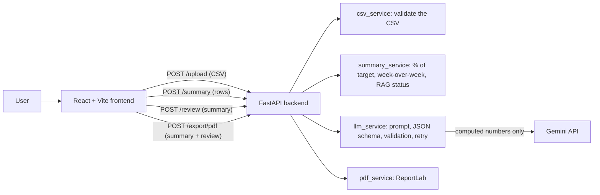

# KPilot

**The AI copilot for your weekly KPIs.** Upload a CSV of weekly numbers, see every brand against target in red, amber and green, and let Gemini draft the review pack: a headline, ranked risks, and follow-ups with an owner and a deadline. Edit it, then export a PDF.

> **Note:** all data in the demo is synthetic sample data, generated for demonstration. It does not describe any real business.

## The problem

A weekly business review usually starts with someone copying numbers from a spreadsheet into slides, deciding what is off track, and writing the same kind of summary every Monday. KPilot automates that routine: the numbers are computed deterministically, and the AI only writes the narrative on top of them.

## Features

- **CSV upload with clear validation.** Drag and drop a file or load the built-in sample. Errors name the exact CSV line that is wrong.
- **Red, amber and green status** for every brand and metric: on track at 100% of target or more, watch from 80%, off track below 80%.
- **Week-over-week change** on every metric tile, and a trend chart of actual against target for any brand and metric.
- **AI review pack** written by Gemini: a headline, a summary per brand, ranked risks, and follow-ups with an owner role, a deadline and a priority.
- **Editable follow-ups.** Change the task, owner or deadline before exporting.
- **PDF export** with an overview page and one page per brand, each with a KPI table, risks and a follow-up table.
- **Accessible by design.** A skip link, status always shown as text as well as colour, a data table behind the chart for screen readers, live-region messages, visible focus rings and reduced-motion support.

## How it works



1. `/upload` validates the CSV with Pandas and returns the parsed rows.
2. `/summary` takes those rows and computes each brand and metric's latest-week result, percent of target, week-over-week change and RAG status.
3. `/review` sends **only the computed summary** to Gemini and returns a validated review.
4. `/export/pdf` renders the summary and the (edited) review as a PDF.

## Tech stack

| Layer    | Tools                                                              |
| -------- | ------------------------------------------------------------------ |
| Backend  | Python, FastAPI, Pandas, Pydantic, pydantic-settings               |
| AI       | Google Gemini through the `google-genai` SDK (model set in `.env`) |
| PDF      | ReportLab                                                          |
| Frontend | React, Vite, Tailwind CSS v3, Recharts                             |
| Tests    | pytest                                                             |

## Getting started

**You need:** Python 3.10 or newer, Node.js 20.19 or newer, and a free Gemini API key from [Google AI Studio](https://aistudio.google.com/apikey).

Clone the repository and open a terminal in its root folder.

### 1. Backend

Windows (PowerShell):

```powershell
cd backend
python -m venv .venv
.venv\Scripts\Activate.ps1
pip install -r requirements.txt
Copy-Item .env.example .env
```

macOS or Linux:

```bash
cd backend
python3 -m venv .venv
source .venv/bin/activate
pip install -r requirements.txt
cp .env.example .env
```

Open `backend/.env` and set `GEMINI_API_KEY` to your key. Then start the API:

```bash
uvicorn app.main:app --reload --port 8000
```

Check it at http://localhost:8000/health. Interactive API docs are at http://localhost:8000/docs.

| Variable         | Meaning                                                                                                                | Default in `.env.example` |
| ---------------- | ---------------------------------------------------------------------------------------------------------------------- | ------------------------- |
| `GEMINI_API_KEY` | Your Gemini API key (required)                                                                                         | placeholder               |
| `GEMINI_MODEL`   | Gemini model name. Model availability differs between accounts, so change it here if you get a "model not found" error | `gemini-3.5-flash`        |
| `CORS_ORIGINS`   | Allowed frontend origins, comma separated                                                                              | `http://localhost:5173`   |

### 2. Frontend

In a second terminal, from the repository root:

```bash
cd frontend
npm install
npm run dev
```

Open http://localhost:5173 and choose **Try the live demo**. The frontend talks to `http://localhost:8000` unless you set `VITE_API_BASE_URL` in `frontend/.env` (see `frontend/.env.example`). Restart the dev server after changing it.

## CSV format

A CSV with these five columns (header names are not case sensitive):

```csv
week_start,brand,metric,actual,target
2026-11-02,SkillfyAI,leads,1480,1400
2026-11-09,SkillfyAI,leads,1540,1421
```

- `week_start` is a date as `YYYY-MM-DD`
- `actual` and `target` are plain numbers (no commas or currency symbols), and `target` must be greater than 0
- each week, brand and metric combination appears once
- UTF-8 text, up to 2 MB
- higher is better for every metric
- metric names ending in `_inr` are shown as rupees (for example `Rs 4.2 lakh`), and names containing `rate` or `conversion` are shown as percentages

The sample file, `backend/data/sample_kpis.csv`, covers 8 weeks, 3 brands and 4 metrics (96 rows) and is created by `backend/scripts/generate_sample.py`. If you regenerate it, copy it to `frontend/public/sample_kpis.csv`, which is the copy the demo button loads.

## API

| Method and path    | Purpose                             | Request                           | Response and errors                                                                                                                                    |
| ------------------ | ----------------------------------- | --------------------------------- | ------------------------------------------------------------------------------------------------------------------------------------------------------ |
| `GET /health`      | Liveness check                      | none                              | `{"status": "ok", "model": "..."}`                                                                                                                     |
| `POST /upload`     | Validate and parse a CSV            | multipart form field `file`       | `rows`, `brands`, `metrics`, `weeks`, `latest_week`. `400` with the reason if the CSV is invalid, `413` if over 2 MB                                   |
| `POST /summary`    | Latest-week summary with RAG status | `{"rows": [...]}`                 | `latest_week` and `summaries`, each with `brand`, `metric`, `actual`, `target`, `pct_achieved`, `wow_change`, `rag_status`. `400` if there are no rows |
| `POST /review`     | Gemini-written review               | the `/summary` response           | `headline`, `brand_summaries`, `risks`, `follow_ups`. `400` if there is nothing to review, `502` if Gemini fails                                       |
| `POST /export/pdf` | Render the review pack              | `{"summary": ..., "review": ...}` | the PDF as a download. `400` if there is nothing to export                                                                                             |

Every error response has the shape `{"detail": "a readable message"}`.

## Design decisions

- **Code computes the numbers, the model writes the words.** Percent of target, week-over-week change and RAG status are calculated with Pandas. Gemini never does arithmetic, so the figures it quotes come from the data.
- **Only computed summaries go to Gemini, never raw rows.** This keeps prompts small and limits what leaves the machine.
- **Strict, checked output.** Gemini is asked for JSON matching a Pydantic schema. The reply is validated, and also checked for the things a schema cannot express: one summary per brand, no invented brand names, a follow-up for every brand with an amber or red metric, and deadlines in the week after the reviewed week. If validation fails, it retries once with the reason. Timeouts and server errors are retried separately.
- **Owners are roles, not names.** The prompt requires placeholders such as "Sales lead", so the model never invents people.
- **Status follows the displayed number.** The RAG status is decided on the percentage rounded to one decimal, so a tile never shows 100.0% in amber.
- **A stateless backend.** The browser holds the uploaded data and sends it with each request, so the API needs no database and a restart loses nothing.
- **Colour is reserved for meaning.** Red, amber and green appear only to show status, and every status badge also carries a text label.
- **Lazy-loaded charts.** The dashboard and Recharts load as a separate chunk, so the first screen stays light.

## Testing

```bash
cd backend
python -m pytest -v
```

The tests cover the RAG thresholds and their boundaries, rounding, latest-week selection, week-over-week change (including a missing or zero previous week), grouping and ordering, bad input, and a check against the generated sample data.

## Project structure

```text
.
├── backend/
│   ├── app/
│   │   ├── main.py              FastAPI app, CORS, router wiring
│   │   ├── config.py            settings loaded from .env
│   │   ├── schemas.py           Pydantic request and response models
│   │   ├── routers/             upload.py, summary.py, review.py, export.py
│   │   └── services/            csv_service.py, summary_service.py,
│   │                            llm_service.py, pdf_service.py
│   ├── data/sample_kpis.csv     synthetic sample data
│   ├── scripts/generate_sample.py
│   ├── tests/test_summary.py
│   ├── requirements.txt
│   └── .env.example
└── frontend/
    ├── public/                  sample_kpis.csv, favicon.svg
    ├── src/
    │   ├── api/client.js        API client with readable errors and timeouts
    │   ├── App.jsx
    │   └── components/          Hero, HowItWorks, Features, SiteHeader,
    │                            SiteFooter, UploadPanel, Dashboard,
    │                            ReviewPanel, ui/ (Card, Badge, Button, StatTile)
    ├── tailwind.config.js       one typeface pair and a restrained palette
    └── .env.example
```

## Limitations

- **Nothing is saved.** Reviews and uploads live in the browser tab. Refreshing the page clears them.
- **The AI's wording is not fact-checked against the data.** The structure of the review is validated, but a number quoted in a sentence is not compared with the source, so read it before you send it.
- **Higher is always better.** Metrics where lower is better (churn, cost per lead) would currently be rated backwards.
- **Fixed thresholds.** The 100% and 80% cut-offs are constants in `summary_service.py`, not settings in the interface.
- **Latest week only.** The status tiles describe each brand and metric's most recent week. Earlier weeks appear in the trend chart.
- **No sign-in and no multi-user support.**
- **The PDF uses built-in fonts.** Characters outside that set (such as the rupee sign) are replaced, so amounts print as `Rs`.
- **Gemini availability and speed vary.** Free-tier limits apply, and a busy model can take up to a minute, so the interface shows its progress and offers a retry.

## Possible next steps

- Choose per metric whether higher or lower is better
- Make the thresholds editable in the interface
- Save reviews so they can be compared week to week
- Add sign-in and per-team workspaces

---

Built by Harshita
